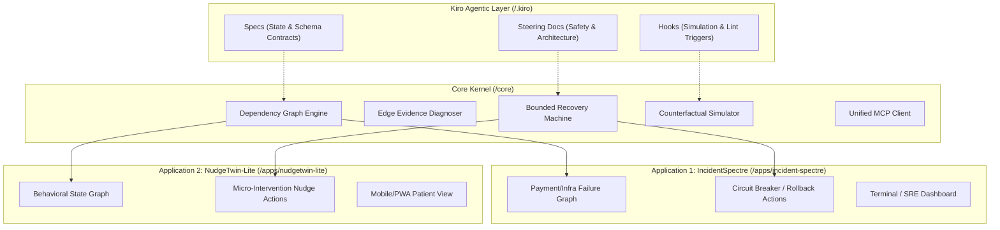

# SKELETON CREW TRACK: ATLAS-Kiro (The Bounded Agentic Kernel)
**Track:** Skeleton Crew  
**Target Category:** Best Skeleton Crew ($5,000) + Overall Placement ($10,000 - $30,000)  
**Author:** Mridul Mathur  
**Repository Architecture:** Foundation Kernel (`/core`) + 2 Distinct Specialized Demo Applications (`/apps/incident-spectre` & `/apps/nudgetwin-lite`)

---

## 1. Executive Summary & Pitch

### The Pitch
Most modern AI agents fail in production because they are built on unstructured, unbounded prompt loops that drift, hallucinate, spin in infinite retries, and rack up immense API bills. **ATLAS-Kiro** is a production-grade, local-first starter foundation for **Bounded Agentic Systems**. It provides a minimal, hardened architectural kernel that combines **explicit dependency graph execution**, **per-edge evidence diagnosis**, **bounded state recovery**, and **counterfactual simulation**.

To fulfill the strict *Skeleton Crew* track requirement (a reusable foundation powering multiple distinct applications), the repository provides the core kernel alongside **two radically different, fully functional demo applications** in independent folders:
1. **`IncidentSpectre`**: An autonomous Cloud SRE & Payment Pipeline triage engine that diagnoses transaction failures and initiates bounded rollbacks.
2. **`NudgeTwin-Lite`**: An adaptive behavioral health micro-intervention agent that personalizes patient lifestyle nudges within strict clinical safety bounds.

---

## 2. Problem Statement & Value Proposition

### The Problem
* **Unbounded Agent Loops:** Current agent frameworks (LangChain, AutoGen) allow LLMs to freely select tools in open loops without formal bounds, leading to runaway recursion, state corruption, and unpredictable costs.
* **Lack of Diagnostic Evidence:** When an agent fails, developers only get a raw text trace rather than an explicit causal dependency graph explaining *why* a particular decision path failed.
* **The Scaffold Crisis:** Developers building specialized agents (fintech, health, devops) repeatedly reinvent state machines, telemetry, and guardrails from scratch.

### The Value Proposition
* **Deterministic Guarantees on Non-Deterministic Models:** ATLAS-Kiro wraps stochastic LLM outputs inside mathematically bounded recovery state machines.
* **Immediate Reusability:** Any developer can clone ATLAS-Kiro and scaffold a reliable, observable agent in under 15 minutes by defining three files: an entity graph schema, a boundary policy, and an action registry.
* **Kiro-Native by Design:** The entire scaffold is built to be driven, tested, and validated by Kiro specs, hooks, and steering docs.

---

## 3. Core Architectural Blueprint

### System Topology



### Key Subsystems in `/core`
1. **Graph-Based Diagnostic Engine:**
   * Models domain workflows not as text chains, but as directed acyclic graphs (DAGs) of typed nodes (States) and edges (Transitions/Dependencies).
   * Edge evaluation requires concrete, typed evidence (payload assertions, status codes, telemetry metrics).
2. **Bounded State Recovery Machine:**
   * Enforces hard limits: maximum step depth ($N \le 5$), budget cap ($T \le 2000$ tokens per remediation), and prohibited fallback cascades.
   * If an agent cannot resolve an issue within its bounds, it deterministically yields to a safe "Circuit Breaker" state rather than hallucinating.
3. **Deterministic Simulator & Counterfactual Harness:**
   * Before applying any real-world state mutation, the agent runs a fast, in-memory counterfactual simulation to predict side effects.

---

## 4. The Kiro Showcase (`/.kiro` Directory)

This project highlights Kiro as a first-class engineering partner:

### `/.kiro/specs/`
* **`kernel-state-machine.spec.json`**: Formal specification defining the generic state transition interface, timeout budgets, and rollback protocols.
* **`evidence-schema.spec.json`**: JSON Schema definitions for typed edge evidence across diagnostic graphs.
* **`app-incident-spectre.spec.json`**: Application-level spec for payment failure taxonomy (e.g. gateway timeout, fraud threshold, token expiry).
* **`app-nudgetwin.spec.json`**: Application-level spec for behavioral nudge states (e.g. baseline, sedentary warning, fatigue mitigation).

### `/.kiro/hooks/`
* **`pre-commit-simulate.hook.ts`**: Runs the counterfactual simulator on all test graphs whenever a transition definition is modified.
* **`schema-validator.hook.ts`**: Verifies that any new action registered in `/apps` strictly inherits and fulfills the `/core` boundary interface.
* **`cost-budget-check.hook.ts`**: Analyzes prompt templates and tool schemas to statically verify token consumption bounds.

### `/.kiro/steering/`
* **`architecture-invariants.md`**: Directs Kiro agents that the `/core` kernel must remain zero-dependency on external cloud providers, remaining purely local-first (Python/FastAPI or Node/TypeScript).
* **`bounded-safety-rules.md`**: Directives ensuring no agent loop is created without an explicit termination condition and timeout boundary.

---

## 5. The Two Demo Applications

### App 1: `IncidentSpectre` (Cloud/Payment SRE Autopilot)
* **Location:** `/apps/incident-spectre`
* **Domain:** Payment orchestration failure recovery (inspired by ARIA).
* **Workflow:**
  * Ingests synthetic webhook failures (e.g., card processor 504 timeout, webhook signature mismatch).
  * Traverses the payment dependency graph to isolate the failing node.
  * Recommends and executes a bounded action: e.g., re-routing traffic through an alternate gateway or gracefully executing an idempotency-safe retry.

### App 2: `NudgeTwin-Lite` (Personalized Behavioral Health Nudge Engine)
* **Location:** `/apps/nudgetwin-lite`
* **Domain:** Preventative health and habit adherence (inspired by CueZen nudge methodology).
* **Workflow:**
  * Ingests user activity signals (step deficit, late-night screen time, skipped hydration).
  * Traverses the patient's behavioral habit graph.
  * Selects an optimal micro-nudge (timing, tone, actionable prompt) while strictly respecting safety bounds (e.g., never nudging during sleep hours, avoiding alert fatigue).

---

## 6. Directory Layout

```text
ATLAS-Kiro/
├── .kiro/
│   ├── specs/
│   │   ├── kernel-state-machine.spec.json
│   │   ├── evidence-schema.spec.json
│   │   ├── incident-spectre.spec.json
│   │   └── nudgetwin-lite.spec.json
│   ├── hooks/
│   │   ├── pre-commit-simulate.hook.ts
│   │   └── schema-validator.hook.ts
│   └── steering/
│       ├── architecture-invariants.md
│       └── bounded-safety-rules.md
├── core/
│   ├── graph/
│   │   ├── engine.py (or .ts)
│   │   └── evidence.py
│   ├── recovery/
│   │   ├── machine.py
│   │   └── circuit_breaker.py
│   ├── simulation/
│   │   └── counterfactual.py
│   └── mcp/
│       └── client.py
├── apps/
│   ├── incident-spectre/
│   │   ├── src/
│   │   ├── tests/
│   │   └── README.md
│   └── nudgetwin-lite/
│       ├── src/
│       ├── tests/
│       └── README.md
├── LICENSE (MIT)
└── README.md
```

---

## 7. 3-Minute Demo Video Walkthrough Script

* **0:00 - 0:40 (The Hook & The Crisis):**
  * "AI agents today are running wild in production—infinite loops, runaway token costs, and zero predictability. Meet ATLAS-Kiro: a lightweight, production-grade starter kernel for bounded, verifiable agent systems."
* **0:40 - 1:20 (The Core Foundation):**
  * Show the `/core` architecture in Kiro IDE.
  * Show the Kiro specs defining the boundary constraints and the automated hook running the counterfactual simulation on save.
* **1:20 - 2:05 (Demo 1 - IncidentSpectre):**
  * Fire a simulated payment gateway outage. Watch the agent trace the dependency graph, inspect edge evidence, simulate a recovery route, and execute a bounded recovery in under 2 seconds.
* **2:05 - 2:40 (Demo 2 - NudgeTwin-Lite):**
  * Switch to the second application built on the exact same kernel. Show a diabetic/sedentary patient state graph. Watch the agent pick a micro-nudge while respecting sleep and fatigue boundary bounds.
* **2:40 - 3:00 (The Pitch to Judges):**
  * "Two completely different industries—FinOps and Digital Health—powered by one single, battle-tested Kiro-driven foundation. Clone it, define your graph, and ship bounded agents."

---

## 8. Judging Criteria Alignment Matrix

| Criterion | Weight | Score Strategy |
| :--- | :--- | :--- |
| **Potential Value** | 20% | Direct enterprise relevance: addresses multi-billion-dollar reliability and safety headaches across devops and healthtech. |
| **Tech Implementation** | 20% | Deep, authentic usage of Kiro specs, steering docs, and automated hooks running counterfactual checks. |
| **Design** | 20% | Clean terminal / web dashboard with real-time graph visualization and intuitive trace inspection. |
| **Innovation** | 20% | Unifying graph causality, bounded state machines, and generative AI into a reusable starter kit. |
| **Presentation** | 20% | High-energy, crisp 3-minute video showing two distinct applications running live from the same foundation. |
