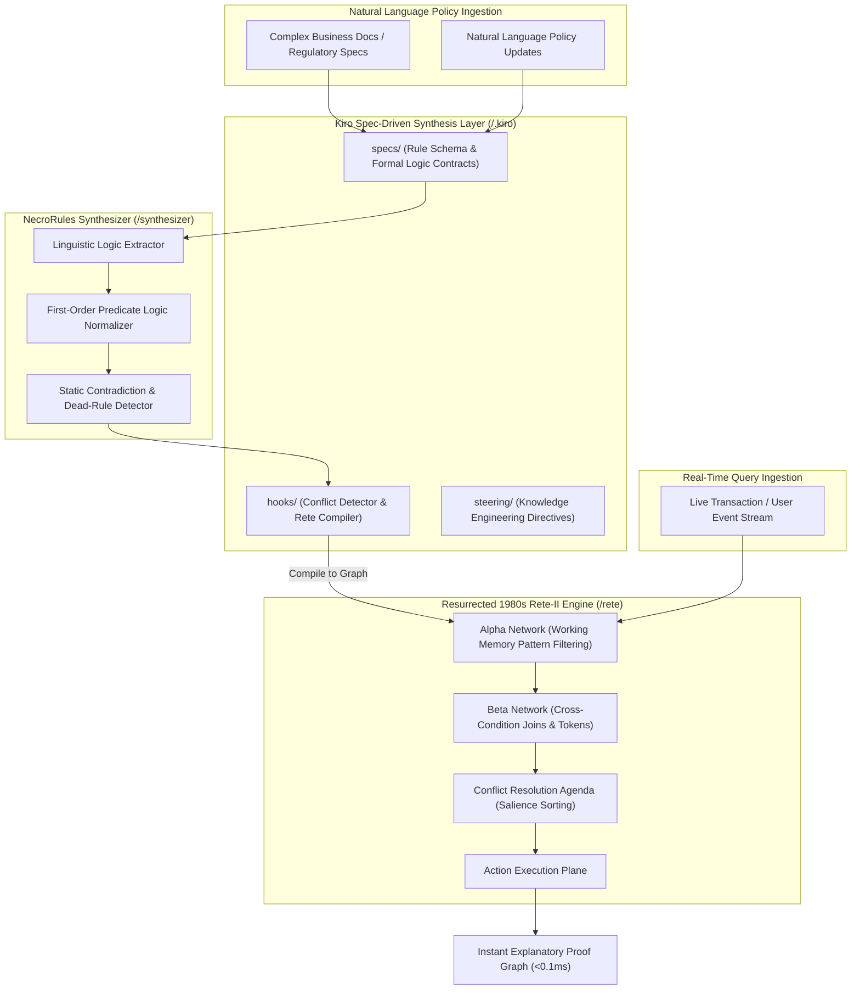

> **Superseded.** This is an early planning document. The current design is `SPEC_GATE_v2.md` and `.kiro/specs/gate/`. Where this file differs from the repo, the repo is right (for example the UI is React with Vite).

# RESURRECTION TRACK: NecroRules (1980s Expert Systems & The Rete Algorithm Revived)
**Track:** Resurrection  
**Target Category:** Best Resurrection ($5,000) + Overall Placement ($10,000 - $30,000)  
**Author:** Mridul Mathur  
**Repository Architecture:** Rete Rule Engine (`/rete`) + Spec-Driven Rule Synthesizer (`/synthesizer`) + Execution Plane (`/engine`) + Live Graph Visualizer (`/visualizer`)

---

## 1. Executive Summary & Pitch

### The Pitch
In the 1980s, Artificial Intelligence was synonymous with **Expert Systems** (powered by Charles Forgy’s legendary **Rete Algorithm**, CLIPS, and forward-chaining inference engines). They promised human-level institutional reasoning with microsecond speed and complete deterministic explainability. 

Then came the **Second AI Winter**. Expert systems died not because the Rete algorithm failed, but because of the **"Knowledge Engineering Bottleneck"**: human engineers had to manually translate thousands of messy, conflicting real-world policies into rigid rule files by hand. The system collapsed under the weight of human authoring limits.

**NecroRules** resurrects the 1980s Rete expert system from the dead. By pairing Kiro’s **Spec-Driven Development** with modern agentic synthesis, NecroRules solves the fatal flaw of 1980s AI:
* The LLM acts as the **Autonomous Knowledge Engineer**: extracting, normalizing, and compiling natural-language regulations, policies, and contracts directly into formal Rete-network specifications.
* The resurrected **Rete-II Engine** executes those rules at blistering C/Wasm speeds (<0.1ms per decision), with zero token costs on evaluation, mathematical explainability, and guaranteed zero hallucinations.

---

## 2. Problem Statement & Value Proposition

### The Problem
* **The Cost & Latency of GenAI in Production:** Using an LLM to evaluate routine business logic (e.g., insurance claims, compliance checks, discount eligibility) is ridiculously wasteful: it costs $0.02 and takes 1,500ms per call, while hallucinating 3% of the time.
* **The Extinction of Rule Engines:** Classical rule engines died because maintainability was impossible for humans. 5,000 rules became an unmaintainable "spaghetti wall."
* **The Missing Synthesis:** Modern AI is purely statistical/fuzzy, while classic AI was purely symbolic/deterministic. Neither solves enterprise reasoning alone.

### The Value Proposition
* **The Best of Both AI Eras:** 
  * Symbolic AI gives microsecond execution ($<0.1\text{ms}$), $0 token cost, and complete causal audit trails.
  * Generative AI (via Kiro) provides infinite patience to read, parse, synthesize, and maintain the rule graph.
* **Sub-Millisecond Edge Execution:** Once Kiro compiles the spec into a Rete graph, the compiled artifact runs locally, in the browser, or at the edge on AWS Lambda with zero external API dependencies.

---

## 3. Core Architectural Blueprint

### System Topology



### The Rete Algorithm Architecture
1. **Working Memory Elements (WMEs):** Facts entering the system (e.g. `(Transaction id:101, amount:5000, country:"US")`).
2. **Alpha Network (One-Input Nodes):** High-speed filter nodes testing individual attribute predicates (`amount > 1000`).
3. **Beta Network (Two-Input Nodes):** Joins multiple conditions across memory tokens, caching partial matches so re-evaluation takes $O(1)$ amortized time.
4. **Explanatory Proof Engine:** Every fired rule outputs the exact deterministic chain of Alpha and Beta activations, providing an instant audit graph for regulators.

---

## 4. The Kiro Showcase (`/.kiro` Directory)

NecroRules showcases Kiro’s spec-driven development and hooks at the deepest level:

### `/.kiro/specs/`
* **`rete-rule-grammar.spec.json`**: Formal schema defining rule conditions (LHS: Left-Hand Side), actions (RHS: Right-Hand Side), priorities (salience), and truth maintenance.
* **`wme-fact-types.spec.json`**: Data contracts for Working Memory Elements across target domains (Fintech, Health, E-commerce).
* **`policy-synthesis-contract.spec.json`**: Specification directing the Kiro agent on how to extract unambiguous predicates from ambiguous human text.

### `/.kiro/hooks/`
* **`compile-rete-graph.hook.ts`**: Automatically compiles raw rule specs into an optimized binary Rete DAG on every git commit.
* **`detect-rule-conflicts.hook.ts`**: Statically analyzes the Rete network to flag rule shadowings (rules that can never fire) or cyclic infinite loops before deployment.
* **`benchmark-inference-latency.hook.ts`**: Benchmarks the compiled Rete graph against 10,000 synthetic facts to guarantee $<1\text{ms}$ execution latency.

### `/.kiro/steering/`
* **`knowledge-engineering-conventions.md`**: Directs Kiro agents to avoid speculative rules, enforce strict predicate normalization, and require explicit unit-test facts for every synthesized rule.
* **`rete-optimization-guidelines.md`**: Rules for optimizing Beta join ordering to minimize token memory consumption.

---

## 5. Implementation & Tech Stack

* **Core Engine:** TypeScript / Rust compiled to WebAssembly (Wasm) for ultra-fast in-memory Rete evaluation.
* **Synthesizer:** Kiro Agent prompts + AST code generation scripts.
* **Interactive Workbench:** React (Vite) + React Flow + Lucide Icons:
  * Left Panel: Natural language policy input (e.g. paste a 3-page return policy or lending rulebook).
  * Center Panel: Real-time visual rendering of the compiled Rete Alpha/Beta network DAG with live fact tokens flowing through nodes.
  * Right Panel: Interactive fact injection sandbox with microsecond execution timer and causal proof inspector.

---

## 6. Directory Layout

```text
NecroRules/
├── .kiro/
│   ├── specs/
│   │   ├── rete-rule-grammar.spec.json
│   │   ├── wme-fact-types.spec.json
│   │   └── policy-synthesis-contract.spec.json
│   ├── hooks/
│   │   ├── compile-rete-graph.hook.ts
│   │   ├── detect-rule-conflicts.hook.ts
│   │   └── benchmark-inference-latency.hook.ts
│   └── steering/
│       ├── knowledge-engineering-conventions.md
│       └── rete-optimization-guidelines.md
├── rete/
│   ├── alpha_node.ts
│   ├── beta_node.ts
│   ├── working_memory.ts
│   └── agenda.ts
├── synthesizer/
│   ├── nlp_to_predicates.ts
│   └── conflict_analyzer.ts
├── workbench/
│   ├── src/
│   │   ├── components/ReteVisualizer.tsx
│   │   ├── components/FactSandbox.tsx
│   │   └── pages/index.tsx
├── examples/
│   ├── fintech_loan_approval.rules.json
│   └── healthcare_triage.rules.json
├── LICENSE (MIT)
└── README.md
```

---

## 7. 3-Minute Demo Video Walkthrough Script

* **0:00 - 0:45 (The History & The Resurrection):**
  * "In 1980, the Rete algorithm powered the first AI revolution. But it died because humans couldn't manually maintain 10,000 complex rules. Today, we bring it back from the grave. Meet NecroRules: 1980s microsecond speed powered by 2026 Kiro spec-driven synthesis."
* **0:45 - 1:30 (The Live Synthesis):**
  * Paste a complex, messy 3-paragraph corporate lending policy into the UI.
  * Run Kiro’s spec synthesis. Watch the Kiro hook trigger, detect a conflicting clause, resolve it, and instantly compile the text into an optimal Rete Alpha/Beta network.
* **1:30 - 2:15 (The Microsecond Speed Test):**
  * Pump 5,000 live loan applicant facts into the engine in real time.
  * Show the stopwatch: **0.12 milliseconds per decision**. Compare this on-screen to an LLM call (1,800ms and $0.03 per call).
  * Click on an approval to reveal the instant, mathematically verifiable proof tree.
* **2:15 - 2:45 (The Kiro Engineering Magic):**
  * Show the `.kiro/specs/` and `.kiro/hooks/` running continuous conflict detection and rule-space compilation.
* **2:45 - 3:00 (The Closing Pitch):**
  * "Classical AI had the speed and determinism; Modern AI has the comprehension. NecroRules resurrects the best of the past with the best of the present. Zero hallucinations. Microsecond latency. Zero API bills."

---

## 8. Judging Criteria Alignment Matrix

| Criterion | Weight | Score Strategy |
| :--- | :--- | :--- |
| **Potential Value** | 20% | Huge cost-savings narrative: eliminates thousands of dollars in unnecessary LLM inference calls for deterministic business rules. |
| **Tech Implementation** | 20% | High-level technical execution: real implementation of the Rete algorithm compiled via Kiro specs and hooks. |
| **Design** | 20% | Stunning live visualizer showing Alpha/Beta node activations and fact tokens flowing through the graph. |
| **Innovation** | 20% | Brilliant theme fit for Resurrection: reviving the forgotten hero of the First AI Winter with 2026 Agentic AI. |
| **Presentation** | 20% | Mesmerizing side-by-side comparison: 0.1ms Rete execution vs. 2,000ms LLM spinner. |
